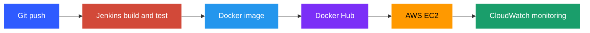

<!-- Replace YOUR_USERNAME and YOUR_LINKEDIN before committing -->

  

  

  
  
  
  

---

## About me

- AWS Certified Solutions Architect with a **6-month DevOps internship** at **DAP Infotech, Ahmedabad** (Jan to Jul 2026)
- Skilled in Linux administration, Git, Docker, Jenkins CI/CD and AWS (EC2, VPC, IAM, CloudWatch)
- Experienced in provisioning and automating cloud infrastructure and deployment workflows
- Quick learner with hands-on experience building Dockerized environments and monitoring production systems
- MCA from Acropolis Institute of Technology and Research, Indore (CGPA 7.64 / 10)
- Based in Khacharod, Ujjain, Madhya Pradesh

 

## Tech stack

  

| Area | Skills |
| --- | --- |
| Cloud (AWS) | EC2, S3, IAM, VPC, Security Groups, Load Balancer, CloudWatch, RDS, DynamoDB |
| Containers | Docker, Dockerfile, Docker Volume, Docker Network, Docker Hub, Kubernetes (basics) |
| CI/CD | Jenkins (Pipeline, Agents), Git, GitHub |
| Linux and scripting | Ubuntu, Bash, cron, systemctl, top, netstat |
| Networking | HTTP/HTTPS, TCP/IP, DNS, Subnetting, CIDR, OSI model, Load balancing |
| System design | Horizontal and vertical scaling, caching, CDN, sharding, replication |
| AI tools | ChatGPT, Claude, Lovable, Ollama, Gemini |

## How I ship

## Experience

**DevOps Intern, DAP Infotech, Ahmedabad** (January 2026 to July 2026)

- Practiced Linux administration: file permissions, user management, process handling, cron, systemctl, top and netstat
- Wrote a Bash script to monitor CPU and memory usage, scheduled it with cron and maintained it in GitHub with branching and pull requests
- Applied networking fundamentals (OSI model, DNS, HTTP, TCP/IP) with curl, netcat and traceroute for client-server troubleshooting
- Built and managed Docker containers and images for application deployment
- Configured and managed Jenkins pipelines to automate build, test and deployment (CI/CD)
- Worked hands-on with AWS: VPC, subnets, EC2, S3, RDS, IAM, CloudWatch, Auto Scaling and billing management

## Featured project

### Online Shopping App: Dockerized E-Commerce Platform

  
  
  

- Deployed and hosted on **AWS EC2**, publicly accessible over the internet
- Multi-stage Docker builds improved deployment speed by 50% and cut the image size by 1 GB
- Automated setup with Docker installation scripts and Docker Compose

[Live demo](#) | [Source code](#)

## Certifications

  
  

## GitHub stats

  
  

  

## Connect with me

  
  
  

  

